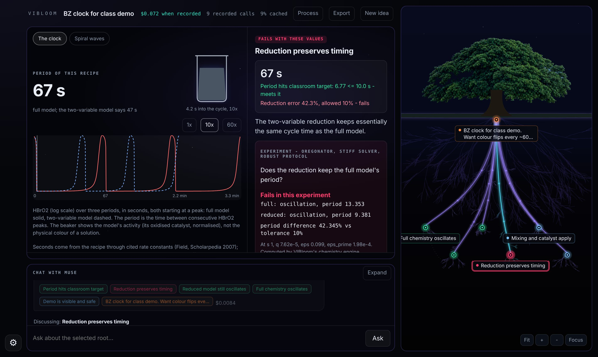
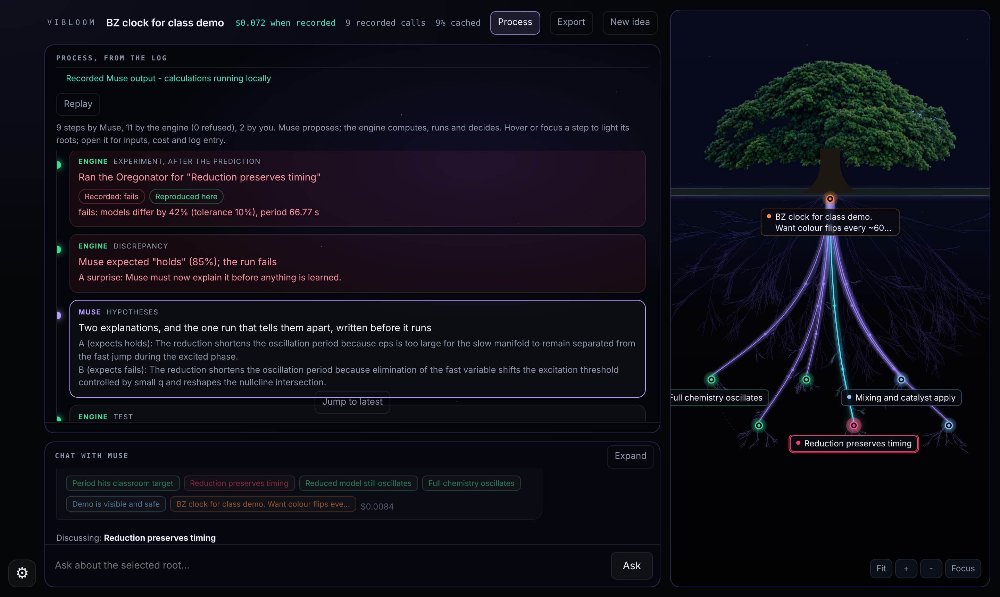

# VIBloom

**A research instrument for chemistry where Muse Spark has to predict each
experiment before it runs, is proven wrong by a stiff solver, and must
explain why in a record anyone can replay.**

VIBloom turns a chemistry question into a tree of the assumptions it rests on.
Muse Spark builds the tree, chooses the experiments, commits to their outcomes
in advance and, when a run contradicts it, registers two explanations and the
one test that tells them apart. A deterministic engine runs every experiment,
decides every verdict and refuses any step that breaks the protocol. Today the
experiments are Oregonator simulations of the Belousov-Zhabotinsky reaction,
built from a real recipe.

Built during the Meta Global AI Developer Hackathon, from November 2, 2026
(first commit). More details in [HACKATHON.md](HACKATHON.md).

- **Live app:** https://viraloyster.github.io/VIBloom/ (three recorded
  sessions replay without a key; with your own Meta Model API key, run new
  ones)
- **Verify without a browser or a key:** `npm ci && npm run verify` replays
  every recorded session, checks its hash chain and runs each experiment
  again (about 6 s)
- **Evaluation:** [docs/evaluation.md](docs/evaluation.md)



## Results

| What                                         | Result                                                                                                                                                         | Where to check                                                                         |
| -------------------------------------------- | -------------------------------------------------------------------------------------------------------------------------------------------------------------- | -------------------------------------------------------------------------------------- |
| A handwritten BZ recipe, tested              | Period 6.5 min against a 60 s target; at 0.2 M malonic acid 67 s, but the two-variable model is then 42% off                                                   | [recorded session](apps/web/public/examples/chemical-clock.json), `npm run verify`     |
| Muse proven wrong, then a discriminating run | Muse predicted the reduction would hold (85%, blind); it failed. Its test (ten times the bromate) contradicts one explanation and is consistent with the other | Same session, Process view                                                             |
| Do lessons change Muse's predictions?        | On a grid frozen before the run: no lesson 6/28 right, lesson as outcomes 22/28, lesson with its measured numbers 26/28 (always "fails": 79%)                  | [evaluation](docs/evaluation.md)                                                       |
| Solver against an independent reference      | Oregonator periods agree with SciPy (Radau) to a relative 5e-4                                                                                                 | [validation](docs/validation.md)                                                       |
| Every recorded run reproduces                | Re-run in the browser and by `npm run verify`, to a relative 1e-4                                                                                              | [`packages/ideas/eval/verify.ts`](packages/ideas/eval/verify.ts)                       |
| Tests                                        | 218, including a regression for every issue found in review                                                                                                    | [`packages/ideas/src/ideas.test.ts`](packages/ideas/src/ideas.test.ts) and per package |

## The problem

Chemistry relies on simplified models because the full ones are expensive or
unwieldy. Whether a simplification still holds at the conditions someone
actually uses is usually assumed, not checked. When a language model is asked,
it answers fluently and confidently, and nothing shows which premises were
computed, which were asserted, or whether the model learns anything when it
turns out to be wrong.

The BZ clock makes this concrete. A teacher wants a colour change every 60 s
and wants to know whether the simpler two-variable Oregonator can be trusted
for planning. Speeding the clock up to meet the target is exactly what breaks
the simplification, and Muse, asked before the run, expected the opposite.

## What happens in a session

1. **The question becomes a tree.** Muse reads the handwritten recipe (vision)
   and grows the assumptions: does the recipe oscillate, does its period hit
   60 s +/- 10, does the reduced model keep the full model's period.
2. **The recipe becomes the model.** The engine converts concentrations into
   Oregonator parameters with cited rate constants and a time scale in
   seconds. Muse cannot set those parameters itself; the engine refuses it.
3. **Muse predicts before every run.** It is shown the assumption, the
   question, the tolerance and the values, never a result. The engine marks
   whether the prediction was blind and scores only blind ones (Brier).
4. **The engine runs the experiment.** A stiff solver integrates both models;
   a classification protocol decides oscillation and the period gap.
5. **A contradiction must be explained before anything is learned.** Muse
   registers two explanations that expect different outcomes and one test,
   either a recipe change (every model parameter follows) or a model change
   (labelled as such). The engine refuses explanations without a contradicted
   prediction, runs the test, and decides which explanation the run is
   consistent with. The lesson keeps the measured contrast apart from the
   interpretation and states that one test does not establish a cause.
6. **The lesson is evidence with conditions.** It records the values,
   question, tolerance, recipe conversion and solver version it was learned
   under, and is fed back to Muse with its measured numbers. If any of those
   change, it stays as history and is no longer offered as a current finding.



## What is new in the design

| Idea                                              | How it is enforced                                                                                                                                                                                                                        |
| ------------------------------------------------- | ----------------------------------------------------------------------------------------------------------------------------------------------------------------------------------------------------------------------------------------- |
| The model proposes; code decides                  | Muse's output is never a result. Every check is parsed by the engine's own arithmetic language or run by the solver; pass and fail are computed ([`tree.ts`](packages/ideas/src/tree.ts), [`expr.ts`](packages/ideas/src/expr.ts)).       |
| Pre-registration as a protocol rule, not a prompt | A prediction is blind only if no run of its values exists; explanations are accepted only after a contradicted prediction and before their test; the test that runs is the one registered. Anything else is refused and logged.           |
| A record anyone can re-execute                    | A hash-chained log. Replay re-verifies every hash, recomputes every formula, refuses a result that does not reproduce, and re-runs each experiment in the browser or with `npm run verify`. A recording replays with its original hashes. |
| Lessons as data with an identity                  | A lesson carries what it depended on; a change invalidates it. Muse receives it with the measured contrast, and the evaluation measures whether that changes its predictions.                                                             |
| The process is visible                            | The Process view reads the log: each step's actor (Muse, engine, person), inputs, cost and log entry; recorded, reproduced and current shown separately; refused attempts listed in place.                                                |

## Where Muse is indispensable

Without Muse there is no tree, no experiment choice, no prediction and no
explanation: the engine only verifies. Each task is Muse's (Meta Model API,
`muse-spark-1.3`, streamed JSON with strict schemas); the right column is what
code does with it.

| Muse                                                            | The engine                                                                  |
| --------------------------------------------------------------- | --------------------------------------------------------------------------- |
| Reads a handwritten recipe or formula (vision)                  | Accepts a formula only in the tree's own parameter names                    |
| Decomposes the question into assumptions with units and sources | Admits only protocol-valid nodes; one value per parameter name              |
| Chooses which experiment tests each assumption                  | Runs the stiff solver and the classification protocol; decides pass or fail |
| Predicts each run with a confidence, before it runs             | Settles it with the run, permanently; scores blind ones only                |
| After a surprise, proposes two explanations and one test        | Refuses them without a contradicted prediction; runs the test; decides      |
| Designs an illustration of the mechanism, then checks a picture | Runs it sandboxed (no network, storage or key); allows one redraw           |
| Answers questions in the chat, seeing the monitor               | Flags numbers absent from the data Muse was given (a heuristic detector)    |

Cost is controlled per request: the API counts input tokens first, the
session reserves the most the request could cost and stops at its budget. The
recorded chemistry sessions cost $0.04 and $0.07.

## Map for reviewers

| To check                                               | Look at                                                                                                                                        |
| ------------------------------------------------------ | ---------------------------------------------------------------------------------------------------------------------------------------------- |
| The rules: gates, statuses, blind predictions, lessons | [`packages/ideas/src/tree.ts`](packages/ideas/src/tree.ts)                                                                                     |
| Muse's prompts and JSON schemas                        | [`packages/ideas/src/protocol.ts`](packages/ideas/src/protocol.ts)                                                                             |
| Calls to the Meta Model API (streaming, vision, cost)  | [`packages/ideas/src/muse.ts`](packages/ideas/src/muse.ts), [`packages/ideas/src/cost.ts`](packages/ideas/src/cost.ts)                         |
| Recipe to model (rate constants, version)              | [`packages/chem/src/recipe.ts`](packages/chem/src/recipe.ts), [docs/science.md](docs/science.md)                                               |
| The stiff solver, the models, the classifier           | [`packages/chem/src/`](packages/chem/src/), validated in [docs/validation.md](docs/validation.md)                                              |
| The arithmetic language (no `eval`)                    | [`packages/ideas/src/expr.ts`](packages/ideas/src/expr.ts)                                                                                     |
| The Process view, read from the log                    | [`apps/web/src/ideas/process.ts`](apps/web/src/ideas/process.ts)                                                                               |
| Faithful replay of a recording                         | `playRecorded` in [`apps/web/src/ideas/main.ts`](apps/web/src/ideas/main.ts), [`packages/ideas/eval/verify.ts`](packages/ideas/eval/verify.ts) |
| The evaluation, its frozen grids and baselines         | [`packages/ideas/eval/`](packages/ideas/eval/), results in [docs/evaluation.md](docs/evaluation.md) and [docs/eval/](docs/eval/)               |
| Tests                                                  | [`packages/ideas/src/ideas.test.ts`](packages/ideas/src/ideas.test.ts), [`packages/chem/src/`](packages/chem/src/)                             |

## Status

| State                              | What                                                                                                                                                                                  |
| ---------------------------------- | ------------------------------------------------------------------------------------------------------------------------------------------------------------------------------------- |
| Live in the public app             | Assumption tree, recipe to model, Oregonator experiments, blind predictions, hypotheses and tests, versioned lessons, Process view, faithful replay, handwriting, chat, illustrations |
| Implemented, not in the public app | Region claims and counterexample search over parameter regions (`apps/api`, `bench.html`, run locally with the Worker)                                                                |
| Not built                          | Other oscillators and reaction models, temperature and reagent depletion, branches of a tree                                                                                          |

## Scope and limits

- **Simulation, not laboratory.** Every verdict comes from the Oregonator, a
  semi-quantitative model of the BZ reaction. The solver is validated against
  SciPy; the model is not validated against measured periods of a real
  beaker. A real recipe can behave differently.
- **One model family.** The questions are oscillation and whether the
  two-variable reduction keeps the period. Temperature and reagent depletion
  are not modelled.
- **The evaluation is small.** One question type, one lesson, two grids. It
  measures whether a recorded lesson changes Muse's predictions on new points
  against simple baselines; it does not show general learning.
- **Outside chemistry, checks compute on assumed numbers.** The app accepts
  any goal and computes the comparisons Muse writes, but there are no
  experiments outside chemistry, so those results are only as good as the
  numbers in the tree, which are shown as assumed.
- **The number detector is heuristic.** It flags numbers absent from Muse's
  data; it cannot prove a number is right.

## Vision

VIBloom is specialising in chemistry first. The engine underneath is general:
every goal rests on assumptions, and the same protocol (decompose, predict
blind, run, contradict, explain, test, learn with conditions) applies to an
engineering design, a mathematical conjecture or a business plan as soon as
that domain has instruments that can settle its questions.

- **Context for machine learning.** Each session produces data that rarely
  exists in a clean form: what a model predicted, with what confidence, what
  the experiment showed, which explanation survived a test and under which
  premises. That record can measure whether a model learns from experiments
  and train models to do research.
- **A workspace for frontier research.** A hosted service where researchers
  develop ideas with Muse against their own instruments and data, keeping
  every conclusion tied to the evidence and premises it depends on.
- **A loop, not a document.** Muse proposes, the engine experiments, Muse is
  wrong in the open, and the tree is refined by what survives.

## Run it

- **No key:** open the [app](https://viraloyster.github.io/VIBloom/) and
  choose a recorded session (the handwritten BZ recipe; Muse surprised and
  learning; the cardboard airliner, a deliberately absurd goal outside
  chemistry). Playback can be paused and stepped; experiments are re-run in
  your browser.
- **With a Meta Model API key:** grow a new tree or write the question by
  hand. The key stays in the tab (or on the device, if you ask) and is sent
  only to api.meta.ai. The session budget limits the tab, not your account.
  Standard mode keeps your content out of Meta's training; contributor mode is
  about 20 times cheaper and allows it.
- **Locally:** `npm ci && npm run dev`. `npm test` runs the tests;
  `npm run verify` re-runs the recorded sessions.

## Repository

```
apps/web          static app: idea tree (index.html), chemistry bench (bench.html)
apps/api          Cloudflare Worker and Durable Objects (region claims, search)
packages/ideas    the tree: protocol, engine rules, Muse client, evaluation, verify
packages/chem     stiff solver, Oregonator models, recipe conversion, classifier
packages/         also contracts, engine (hashing, log), search, agent
tools/reference   SciPy reference data generator
docs/             architecture, science, validation, evaluation
```

## Credits

The canopy artwork (`apps/web/public/crown.webp`) was generated by the author
with an image model and cut out for the interface. The roots are drawn from
project data.

## License

[MIT](LICENSE)
